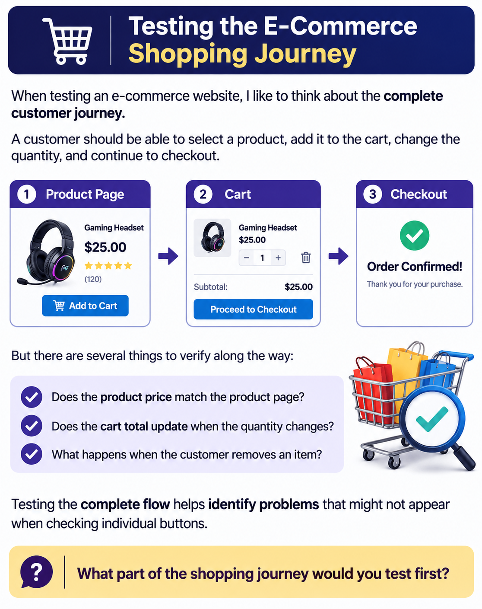

When testing an e-commerce website, I like to think about the complete customer journey.

A customer should be able to select a product, add it to the cart, change the quantity, and continue to checkout.

But there are several things to verify along the way:

- Does the product price match the product page?
- Does the cart total update when the quantity changes?
- What happens when the customer removes an item?

Testing the complete flow helps identify problems that might not appear when checking individual buttons.

**What part of the shopping journey would you test first?**
